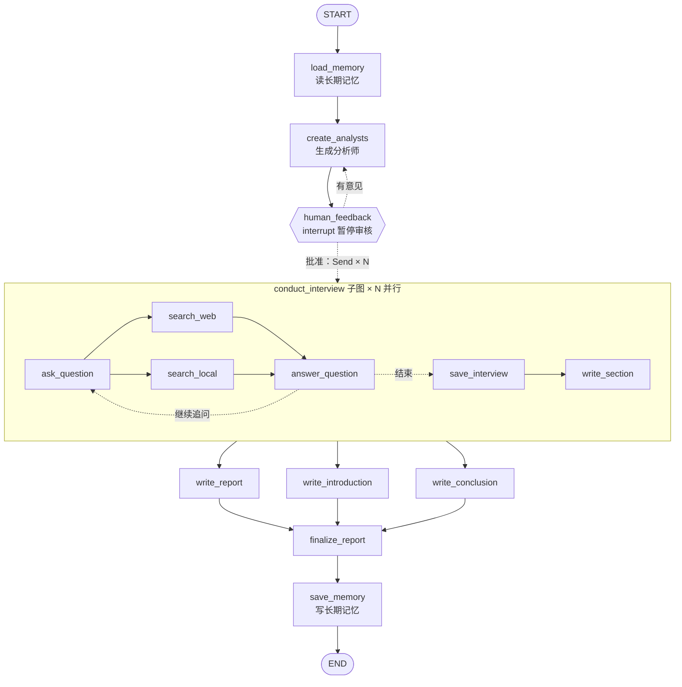

# 研究助手：一个完整的 LangGraph 项目

基于 [langchain-academy](https://github.com/langchain-ai/langchain-academy) module-4 的 Research Assistant 改写，
把 module-1 到 module-5 的核心概念放进同一个可运行的项目里，并且：

- 全部使用 **LangGraph v1 的新写法**（`interrupt()` + `Command`、`Runtime`、`context_schema`）；
- 默认使用 **DeepSeek**（也可以换成通义千问），国内可以直接用；
- 提供 **离线模式 `--mock`**：不需要任何 API key，就能看到整张图是怎么一步步执行的。

## 它做了什么

输入一个研究课题 → AI 生成几位不同角度的分析师 → **暂停，等你审核**（可以提意见让它重新生成）→
每位分析师**并行**去采访一位"专家"（专家会检索资料后回答）→ 每场访谈写成一个小节 →
**并行**撰写正文、引言、结论 → 合并成最终报告 → 把课题记入**长期记忆**。



## 快速开始

```bash
python3 -m venv .venv && source .venv/bin/activate
pip install -r requirements.txt

# 1. 先用离线模式看执行流程（不需要 key）
python main.py "LangGraph 的状态管理" --mock

# 2. 配置真实模型
cp .env.example .env      # 填 LLM_API_KEY（DeepSeek 或通义千问）
python main.py "AI Agent 在国内的落地现状"
```

其他命令：

| 命令 | 作用 |
|---|---|
| `python main.py "课题" --analysts 3 --turns 2` | 3 个分析师（3 个并行子图），每场访谈 2 轮问答 |
| `python main.py "课题" --auto-approve` | 跳过人工审核 |
| `python main.py --thread <id>` | 运行中途按 Ctrl+C 退出后，用这条命令从断点继续 |
| `python main.py --history <id>` | 查看某次运行的所有 checkpoint |
| `python main.py --graph` | 打印图结构（Mermaid 格式，可粘贴到 mermaid.live 查看） |
| `langgraph dev` | 在 LangSmith Studio 里可视化运行（需要能访问 smith.langchain.com） |

想让专家回答得更有依据：往 `knowledge/` 目录里放你自己的 `.md` / `.txt` 资料，或在 `.env` 中配置 `TAVILY_API_KEY` 开启联网搜索。

## 代码阅读顺序

| 顺序 | 文件 | 读懂什么 | 对应 academy |
|---|---|---|---|
| 1 | `research_assistant/state.py` | State、reducer（`operator.add`、`add_messages`）、输入/输出 schema | module-2 |
| 2 | `research_assistant/config.py` | 模型怎么接入；`Context` 和 State 的区别；DeepSeek 结构化输出的坑 | module-1 |
| 3 | `research_assistant/interview.py` | 节点、普通边、并行、条件边、循环、子图、RetryPolicy | module-1、module-4 |
| 4 | `research_assistant/graph.py` | `interrupt()`、`Command`、`Send`、`Runtime`、Store 长期记忆 | module-3、4、5 |
| 5 | `main.py` | checkpointer、thread_id、stream 的几种模式、恢复执行、checkpoint 历史 | module-1、module-3 |
| — | `prompts.py`、`tools.py` | 提示词和检索，非 LangGraph 内容，扫一眼即可 | |
| — | `mock_llm.py` | 离线假模型，**不用读** | |

## 边跑边观察（建议按顺序做）

1. **看并行**：运行 `--mock`，观察 `[conduct_interview#33c5]` 和 `[conduct_interview#c4a2]` 两个子图实例的输出交替出现，说明它们在同时执行。
2. **看 reducer**：把 `state.py` 中 `InterviewState.context` 的 `Annotated[..., operator.add]` 改成普通的 `list[str]` 再运行，你会看到 `InvalidUpdateError`。想一想为什么。
3. **看 interrupt 的"重新执行"**：在 `graph.py` 的 `human_feedback` 函数第一行加 `print("进入 human_feedback")`，会发现每次恢复时它都会打印，因为节点被从头执行了一遍。
4. **看 checkpoint**：运行到审核那一步时按 Ctrl+C，再用 `--thread <id>` 继续；然后用 `--history <id>` 看每一步存下来的状态。
5. **看长期记忆**：用不同的 `--thread` 跑两个课题，第二次运行时 `load_memory` 会读到第一个课题；换一个 `--user` 就读不到了。
6. **看子图输出 schema**：把 `interview.py` 里的 `output_schema=InterviewOutput` 删掉再运行，会报错。原因是子图会把 `max_num_turns` 等字段也交还给父图，多个并行实例同时写父图里同一个没有 reducer 的字段，就冲突了。

## 读懂之后可以做的练习

- 给 `write_report` 加上逐 token 流式输出：使用 `stream_mode=["tasks", "messages"]`。
- 把 `InMemory` / `Sqlite` 换成 `PostgresSaver` / `PostgresStore`。
- 用 FastAPI 包一层，提供 `POST /research`（启动）和 `POST /research/{thread_id}/feedback`（恢复）两个接口，并用 SSE 推送进度。
- 把 `local_search` 换成向量检索（如 Chroma、FAISS）。
